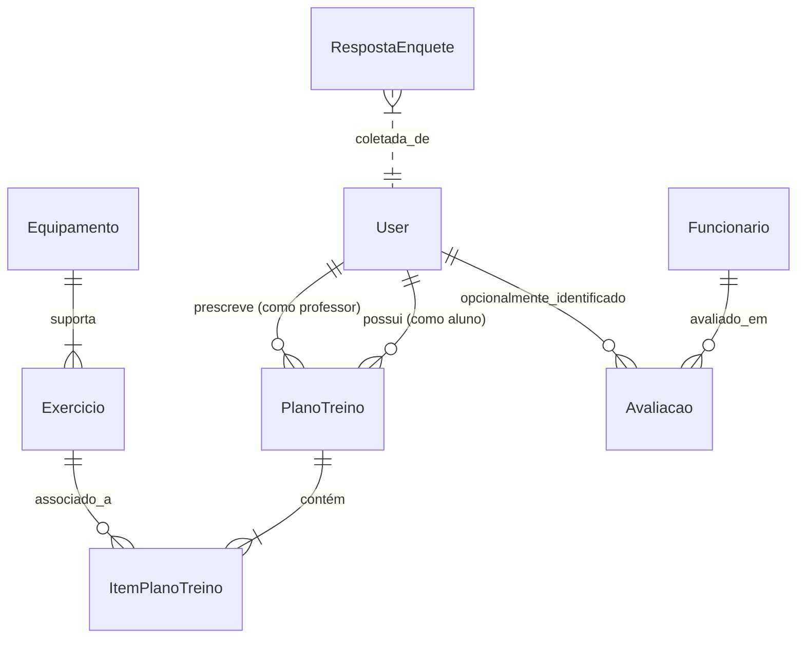

# 🛠️ DOCUMENTAÇÃO TÉCNICA & DEPLOY EM CONTÊINER VPS
**Plataforma Polo Feedback & Treinos — Academia Polo Fit**  
*Manual de Arquitetura, Engenharia de Software e Operações (DevOps)*

---

## 1. ARQUITETURA GERAL DO SISTEMA

```
                    ┌──────────────────────────────┐
                    │       Cliente (Mobile/Web)   │
                    │      PWA / Câmera QR / HTTPS │
                    └──────────────┬───────────────┘
                                   │ HTTPS (:443)
                                   ▼
                    ┌──────────────────────────────┐
                    │      Nginx / Reverse Proxy   │
                    │ SSL/TLS (Let's Encrypt / HSTS│
                    └──────────────┬───────────────┘
                                   │ HTTP (:8000)
                                   ▼
       ┌────────────────────────────────────────────────────────┐
       │                   Gunicorn WSGI Server                 │
       │  ┌──────────────────────────────────────────────────┐  │
       │  │               Django 5.x Application              │  │
       │  │   • Autenticação & RBAC (Aluno / Staff / Admin)  │  │
       │  │   • Gestão de Treinos por QR Code                │  │
       │  │   • Coleta de Avaliações & NPS                   │  │
       │  │   • Enquetes Dinâmicas de Demanda                │  │
       │  │   • Integração com IA Gemini (Diagnósticos)      │  │
       │  └────────────────────────┬─────────────────────────┘  │
       └───────────────────────────┼────────────────────────────┘
                                   │
                    ┌──────────────┴───────────────┐
                    │     PostgreSQL Database      │
                    │  (Persistência Relacional)    │
                    └──────────────────────────────┘
```

### 1.1. Stack Tecnológica
* **Backend**: Python 3.12+ com Django 5.x.
* **Servidor de Aplicação**: Gunicorn com workers síncronos e assíncronos.
* **Banco de Dados**: PostgreSQL 16 (Produção) / SQLite 3 (Ambiente de desenvolvimento local).
* **Frontend**: HTML5 Semântico, CSS3 Moderno, Tailwind CSS, Vanilla JS responsivo (Mobile-First).
* **PWA**: `manifest.json`, Service Worker com suporte offline e ícones em alta resolução.
* **Inteligência Artificial**: API do Google Gemini para resumos executivos automáticos de feedback.

---

## 2. MODELO DE DADOS & ENTIDADES PRINCIPAIS



1. **`User` (Django Contrib Auth)**:
   - Alunos: `is_staff=False`. Acesso restrito a `/aluno/`.
   - Professores / Recepção: `is_staff=True`. Pertence ao grupo de instrutores.
   - Gerentes: `is_superuser=True`. Acesso irrestrito a `/admin/` e painel executivo.
2. **`Equipamento`**:
   - Representa as máquinas físicas do salão (ex: *Leg Press 45°*, *Crossover*, *Supino Reto*). Gera QR Code único via hash/slug.
3. **`Exercicio`**:
   - Variações de movimentos associados a um equipamento específico.
4. **`PlanoTreino` & `ItemPlanoTreino`**:
   - Ficha digital personalizada com séries, repetições, carga prescrita em kg, intervalo em segundos e orientações posturais.
5. **`Avaliacao`**:
   - Registros de NPS (1 a 5 estrelas), categorias (Limpeza, Atendimento, Clima), colaboradores citados e status de resolução gerencial (*Pendente, Em Análise, Resolvido*).

---

## 3. GUIA DE DEPLOY DE CONTÊINER EM VPS (DOCKER & DOCKER COMPOSE)

Este guia orienta o deploy completo em qualquer VPS com Linux Ubuntu 22.04 / 24.04 (DigitalOcean, Hetzner, AWS EC2, Contabo, Linode, Oracle Cloud).

### 3.1. Arquivo `Dockerfile` de Produção
Crie ou verifique o arquivo `Dockerfile` na raiz do projeto:

```dockerfile
# Dockerfile
FROM python:3.12-slim

# Evita criação de arquivos .pyc e força saída direta no stdout/stderr
ENV PYTHONDONTWRITEBYTECODE=1
ENV PYTHONUNBUFFERED=1

WORKDIR /app

# Instala dependências do sistema necessárias para PostgreSQL e Pillow
RUN apt-get update && apt-get install -y --no-install-recommends \
    build-essential \
    libpq-dev \
    gcc \
    curl \
    && rm -rf /var/lib/apt/lists/*

# Copia e instala requirements
COPY requirements.txt /app/
RUN pip install --no-cache-dir --upgrade pip && \
    pip install --no-cache-dir -r requirements.txt && \
    pip install --no-cache-dir gunicorn

# Copia o código da aplicação
COPY . /app/

# Coleta arquivos estáticos
RUN python manage.py collectstatic --noinput

# Expõe a porta interna da aplicação
EXPOSE 8000

# Executa migrações e sobe o Gunicorn
CMD ["sh", "-c", "python manage.py migrate --noinput && gunicorn config.wsgi:application --bind 0.0.0.0:8000 --workers 3 --timeout 120"]
```

---

### 3.2. Arquivo `docker-compose.yml`
Para orquestrar o banco PostgreSQL, a aplicação Django e o Nginx:

```yaml
version: '3.8'

services:
  db:
    image: postgres:16-alpine
    container_name: polofit_postgres
    restart: always
    environment:
      POSTGRES_DB: polofeedback
      POSTGRES_USER: polofit_admin
      POSTGRES_PASSWORD: SuaSenhaSuperSeguraAqui2026!
    volumes:
      - postgres_data:/var/lib/postgresql/data
    healthcheck:
      test: ["CMD-SHELL", "pg_isready -U polofit_admin -d polofeedback"]
      interval: 10s
      timeout: 5s
      retries: 5

  web:
    build: .
    container_name: polofit_django
    restart: always
    depends_on:
      db:
        condition: service_healthy
    environment:
      - SECRET_KEY=defina_uma_chave_secreta_longa_e_aleatoria_aqui
      - DEBUG=False
      - ALLOWED_HOSTS=polofit.com.br,www.polofit.com.br,seu-ip-da-vps
      - DATABASE_URL=postgres://polofit_admin:SuaSenhaSuperSeguraAqui2026!@db:5432/polofeedback
      - GEMINI_API_KEY=${GEMINI_API_KEY}
    volumes:
      - static_volume:/app/staticfiles
      - media_volume:/app/media
    expose:
      - 8000

  nginx:
    image: nginx:alpine
    container_name: polofit_nginx
    restart: always
    ports:
      - "80:80"
      - "443:443"
    volumes:
      - ./nginx/conf.d:/etc/nginx/conf.d
      - ./certbot/conf:/etc/letsencrypt
      - ./certbot/www:/var/www/certbot
      - static_volume:/app/staticfiles
      - media_volume:/app/media
    depends_on:
      - web

volumes:
  postgres_data:
  static_volume:
  media_volume:
```

---

### 3.3. Configuração do Nginx (`nginx/conf.d/default.conf`)

```nginx
server {
    listen 80;
    server_name polofit.com.br www.polofit.com.br;

    location /.well-known/acme-challenge/ {
        root /var/www/certbot;
    }

    location / {
        return 301 https://$host$request_uri;
    }
}

server {
    listen 443 ssl http2;
    server_name polofit.com.br www.polofit.com.br;

    ssl_certificate /etc/letsencrypt/live/polofit.com.br/fullchain.pem;
    ssl_certificate_key /etc/letsencrypt/live/polofit.com.br/privkey.pem;

    ssl_protocols TLSv1.2 TLSv1.3;
    ssl_ciphers HIGH:!aNULL:!MD5;
    client_max_body_size 25M;

    # Arquivos estáticos
    location /static/ {
        alias /app/staticfiles/;
        expires 30d;
        add_header Cache-Control "public, max-age=2592000";
    }

    # Arquivos de mídia
    location /media/ {
        alias /app/media/;
        expires 7d;
    }

    # Proxy reverso para o Django Gunicorn
    location / {
        proxy_pass http://web:8000;
        proxy_set_header Host $host;
        proxy_set_header X-Real-IP $remote_addr;
        proxy_set_header X-Forwarded-For $proxy_add_x_forwarded_for;
        proxy_set_header X-Forwarded-Proto https;
        proxy_redirect off;
    }
}
```

---

### 3.4. Passo a Passo de Execução no Terminal da VPS

1. **Instalar Docker e Docker Compose na VPS**:
   ```bash
   sudo apt update && sudo apt upgrade -y
   sudo apt install -y curl git
   curl -fsSL https://get.docker.com -o get-docker.sh
   sudo sh get-docker.sh
   sudo usermod -aG docker $USER
   ```

2. **Clonar o Repositório**:
   ```bash
   git clone https://github.com/Marcosplira/PoloFeedback.git /opt/polofeedback
   cd /opt/polofeedback
   ```

3. **Subir os Contêineres**:
   ```bash
   docker compose up -d --build
   ```

4. **Criar o Superusuário Inicial**:
   ```bash
   docker compose exec web python manage.py createsuperuser
   ```

5. **Emitir Certificado SSL Gratuito (Certbot Let's Encrypt)**:
   ```bash
   docker run -it --rm --name certbot \
     -v "/opt/polofeedback/certbot/conf:/etc/letsencrypt" \
     -v "/opt/polofeedback/certbot/www:/var/www/certbot" \
     certbot/certbot certonly --webroot -w /var/www/certbot \
     -d polofit.com.br -d www.polofit.com.br
   ```

6. **Rotina de Backup Automático do PostgreSQL (Cron)**:
   Adicione ao crontab do servidor (`crontab -e`):
   ```bash
   0 3 * * * docker exec polofit_postgres pg_dump -U polofit_admin polofeedback | gzip > /backups/polofit_$(date +\%F).sql.gz
   ```

---

## 4. DEPLOY ATUAL EM NUVEM (RENDER)

O projeto também está configurado para deploy contínuo (*Continuous Deployment*) integrado ao GitHub:
1. Ao enviar um commit para a branch `main` (`git push origin main`), o Render detecta a alteração automaticamente.
2. O Render executa:
   - `pip install -r requirements.txt`
   - `python manage.py collectstatic --noinput`
   - `python manage.py migrate`
3. A aplicação reinicia automaticamente com zero downtime no endereço oficial:
   `https://polofeedback.onrender.com/`
